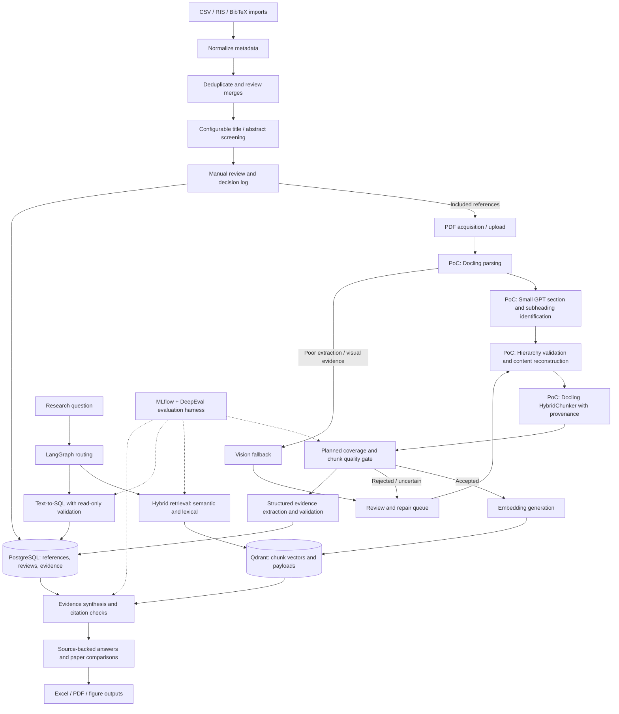

# Evidra AI

**An intelligent research ingestion and evidence retrieval platform.**

Evidra AI is being built to turn research references and full-text papers into traceable evidence for literature screening, paper comparison, structured analysis, and source-backed answers. Its target workflow connects reference imports, human review, document understanding, vector retrieval, and a structured evidence database.

> **Project status: early proof-of-concept.** PDF extraction, model-assisted section identification, hierarchy/content reconstruction validation, and metadata-rich chunking have been demonstrated on three papers. The complete platform described below is the target architecture. Features marked **Planned** are not confirmed implementations.

## Contents

- [Implementation status](#implementation-status)
- [Initial experiment](#initial-experiment)
- [Architecture](#architecture)
- [Complete pipeline](#complete-pipeline)
- [Technology stack](#technology-stack)
- [Evidence and provenance](#evidence-and-provenance)
- [Evaluation](#evaluation)
- [Proposed folder structure](#proposed-folder-structure)
- [Setup and configuration](#setup-and-configuration)
- [Roadmap](#roadmap)
- [Limitations and responsible use](#limitations-and-responsible-use)
- [Contributing and license](#contributing-and-license)

## Implementation status

“Implemented PoC” means reported in the initial experiment; it does not imply production readiness or independent repository verification. No application source code was inspected while preparing this README.

| Component | Status | Scope / next work |
| --- | --- | --- |
| CSV, RIS, and BibTeX import | Planned | Reference ingestion with source tracking and import validation |
| Metadata normalization and deduplication | Planned | Canonical fields, duplicate candidates, and reviewable merges |
| Configurable title/abstract screening | Planned | Protocol-specific criteria and traceable recommendations |
| Manual review | Planned | Inclusion/exclusion decisions, overrides, and conflict resolution |
| PDF acquisition and upload | Planned | Managed acquisition/upload workflow and reference-to-file linkage |
| Docling PDF parsing | Implemented PoC | Extraction of text, headings, tables, images, and page information |
| Small GPT model for sections and subheadings | Implemented PoC | Identification of Abstract, Introduction, Methods, Results, Conclusion, and subheadings without hardcoded section rules; exact model not specified |
| Heading hierarchy and content reconstruction validation | Implemented PoC | Correct heading hierarchy, identify misplaced content, and associate paragraphs with sections; accuracy still requires evaluation |
| Docling HybridChunker | Implemented PoC; refinement ongoing | Metadata-rich chunks with research title, section, page, and source references |
| Content coverage and section-aware chunking verification | Next validation milestone | Establish that important content survives reconstruction and chunking |
| Embeddings and Qdrant indexing | Planned | Generate embeddings and store accepted chunks for retrieval |
| PostgreSQL evidence store | Planned | Structured study evidence, review state, provenance, and versioning |
| LangGraph hybrid RAG and Text-to-SQL | Planned | Route and combine narrative retrieval with structured evidence queries |
| Vision fallback | Planned | Escalation for image-dependent or poorly parsed content |
| Excel, PDF, and figure outputs | Planned | Evidence-linked exports and visualizations |
| MLflow / DeepEval evaluation harness | Planned | Reproducible ingestion, retrieval, SQL, and answer-quality evaluation |

## Initial experiment

| Measure | Reported result |
| --- | ---: |
| Research papers processed | 3 |
| Accepted chunks | 353 |
| Rejected chunks | 4 |
| Total chunks assessed | 357 |

These counts describe the initial chunking experiment. Acceptance criteria and rejection reasons are not yet documented here. “Accepted” does not establish factual correctness, complete content coverage, retrieval relevance, or answer quality. Hundreds or thousands of papers are the intended scale, not a demonstrated throughput result.

The next step is to improve section-aware chunking, verify preservation of important content, and then generate embeddings for Qdrant.

## Architecture

The diagram shows the intended end-to-end system. Only the nodes labeled **PoC** are confirmed by the reported experiment; all other nodes describe planned work.



## Complete pipeline

### 1. Import references — Planned

Accept CSV, RIS, and BibTeX records from reference managers and literature databases. Preserve each source record alongside its normalized representation. Capture import identifiers, source filenames, field mappings, and validation errors so records can be traced back to their origin.

### 2. Normalize metadata and deduplicate — Planned

Normalize titles, author lists, publication years, identifiers, journal names, abstracts, and URLs. Use reliable identifiers such as DOI where available, then generate duplicate candidates from normalized bibliographic fields. Keep potentially different versions, corrections, and related reports distinguishable. Ambiguous matches should enter manual review; merges should preserve source lineage and an audit trail.

### 3. Screen titles and abstracts — Planned

Support configurable review protocols with inclusion/exclusion criteria, population, intervention/exposure, comparator, outcomes, study design, publication period, and language where relevant. Screening recommendations should include a criterion-level rationale and an evidence excerpt when available. Missing abstracts and uncertain classifications should remain reviewable rather than being silently excluded.

### 4. Review decisions manually — Planned

Provide a review queue for inclusion, exclusion, uncertainty, duplicate resolution, and model overrides. Store the reviewer, decision, reason, protocol version, and timestamp. Support disagreement resolution before references advance through the workflow.

### 5. Acquire or upload PDFs — Planned

Link references to user-uploaded or lawfully acquired full-text files. Record acquisition status, file checksum, source, and document version. Route missing files and reference/PDF mismatches to review. Parsing PDFs has been demonstrated; an automated acquisition service and upload interface have not been established.

### 6. Parse documents with Docling — Implemented PoC

Extract text, headings, tables, images, and page information into a document representation. Preserve document elements and their source locations for reconstruction and citation. Document-level failure handling, difficult layouts, and broader corpus performance remain to be validated.

### 7. Identify sections using a small GPT model — Implemented PoC

Use a small GPT model to identify Abstract, Introduction, Methods, Results, Conclusion, and their subheadings across varying paper structures without hardcoding section rules. Papers may omit, rename, or combine sections; the pipeline should preserve original labels and avoid inventing absent content. Exact model identity, prompt version, and inference settings must be documented with the implementation.

### 8. Validate hierarchy and reconstruct content — Implemented PoC

Validate and correct heading hierarchy, identify misplaced content, and associate paragraphs with the appropriate sections. Preserve source order and provenance through reconstruction. The next validation phase should measure section assignment accuracy, incorrect reassignments, omitted elements, and reading-order errors against reviewed annotations.

### 9. Create section-aware chunks — Implemented PoC; refinement ongoing

Use Docling's HybridChunker to produce smaller retrieval units. The PoC includes research title, section, page number, and source references as chunk metadata. Refinement should preserve useful section boundaries, handle oversized tables or paragraphs explicitly, and measure duplication and content loss.

Planned metadata extensions include stable paper/chunk IDs, document hashes, original and normalized heading paths, page spans, element IDs, parser/chunker versions, and validation status. Rejected chunks should retain a reason and source pointer so they can be repaired or explicitly accounted for.

### 10. Generate embeddings and index in Qdrant — Planned

Embed accepted chunks and store vectors with filterable source metadata in Qdrant. Record the embedding model, dimensionality, version, and collection configuration. Support idempotent re-ingestion and invalidation of stale vectors when documents or chunking change. Evaluate semantic retrieval and the planned lexical/semantic combination before relying on them for answers.

### 11. Build a PostgreSQL evidence store — Planned

Store canonical references, document versions, screening decisions, extracted study characteristics, outcomes, provenance, and review status. Candidate evidence fields include population, study design, intervention/exposure, comparator, outcome definition, measurement time, sample size, reported estimate, uncertainty interval, and unit.

Structured evidence extraction is a separate planned step from chunking. Each evidence value should link to its paper, page/element or source span, extraction version, and validation state. Distinguish missing values from reported zeroes and keep incompatible definitions or units explicit.

### 12. Answer questions with LangGraph hybrid RAG and Text-to-SQL — Planned

Use LangGraph to route questions to narrative retrieval, structured queries, or both:

- **Hybrid RAG:** combine semantic and lexical retrieval, with metadata filtering and optional reranking, to locate relevant passages.
- **Text-to-SQL:** query validated structured evidence in PostgreSQL for counts, filters, comparisons, and aggregations.
- **Combined synthesis:** reconcile retrieved passages and structured results, show supporting citations, and identify conflicting findings or insufficient evidence.

The lexical retrieval implementation, reranker, orchestration graph, and SQL schema remain design choices. SQL access should use read-only credentials, schema/table restrictions, statement validation, row limits, and execution timeouts. Answers should distinguish reported findings from synthesis and abstain when support is insufficient.

### 13. Escalate to vision when needed — Planned

Use a vision-capable model for scanned pages, figures, complex tables, or elements with inadequate text extraction. Preserve the page/image reference and label the result as vision-derived. Verify extracted values, axes, legends, units, and labels before incorporating them into structured evidence or quantitative outputs. Vision fallback is not evidence that all visual content has been correctly understood.

### 14. Export results — Planned

- **Excel:** screening logs, evidence matrices, study comparisons, and extraction/review status.
- **PDF:** cited research summaries, comparison reports, and review reports.
- **Figures:** evidence maps and charts based on validated structured data, with units, denominators, and source references.

Exports should include the applicable corpus, protocol/version, generation timestamp, and evidence lineage. Statistical pooling or meta-analysis requires a separate, validated analysis workflow.

## Technology stack

| Layer | Technology / choice | Status |
| --- | --- | --- |
| Document understanding | Docling | Used in PoC |
| Chunking | Docling HybridChunker | Used in PoC |
| Section identification | Small GPT model; exact model to be documented | Used in PoC |
| Application and ingestion runtime | Python; versions/dependencies to be finalized | Proposed |
| Reference import | CSV/RIS/BibTeX parsers; libraries to be selected | Planned |
| Embeddings | Model/provider to be selected and evaluated | Planned |
| Vector database | Qdrant | Planned |
| Structured evidence database | PostgreSQL | Planned |
| Workflow orchestration | LangGraph | Planned |
| Visual interpretation | Vision-capable model/provider to be selected | Planned |
| Experiment tracking | MLflow | Planned |
| LLM evaluation | DeepEval plus task-specific deterministic and human checks | Planned |
| Export layer | Excel/PDF/figure generation; libraries to be selected | Planned |
| API, review UI, job queue, and deployment | To be selected | Not established |

## Evidence and provenance

The proposed data model separates references, document versions, parsed elements, chunks, and structured evidence. Qdrant serves retrieval; PostgreSQL maintains structured records and review state. Stable IDs and version references should connect them.

Proposed minimum lineage:

```text
import record -> canonical paper -> document version -> parsed element
              -> section assignment -> chunk -> retrieved citation
document version / parsed element -> structured evidence -> SQL result
retrieved citation + SQL result -> answer / exported artifact
```

Every transformation should be traceable. Reprocessing should preserve prior versions or record their replacement, and stale evidence should not silently mix with a newer document. Content-coverage checks should account for excluded or rejected material, including tables and image-only evidence.

## Evaluation

The MLflow/DeepEval harness is planned. No retrieval, answer-quality, screening, SQL, or scale benchmark results are claimed here. The three-paper chunk counts are the only reported quantitative experiment results.

| Area | Proposed metrics and checks |
| --- | --- |
| Import and normalization | Parse success, required-field completeness, identifier validity, field-mapping accuracy |
| Deduplication | Precision/recall against adjudicated duplicate groups; false merges and missed duplicates |
| Screening | Sensitivity/recall for eligible studies, precision, specificity, false exclusions, reviewer agreement, manual-review burden |
| Document parsing | Text/table extraction accuracy on reviewed samples, page/source mapping accuracy, reading-order errors |
| Section reconstruction | Section/subheading precision/recall, hierarchy accuracy, paragraph assignment accuracy |
| Chunking | Source-element/token coverage, important-content omissions, duplicate content, section-boundary violations, rejection rate and reasons |
| Structured evidence | Field-level exact match or justified numeric tolerance, unit/timepoint correctness, provenance accuracy |
| Retrieval | Recall@k, Precision@k, MRR, nDCG, section-specific coverage, filter correctness |
| Text-to-SQL | Execution accuracy, result correctness, invalid/unsafe query rejection, empty-result handling |
| Answers and comparisons | Factual correctness, groundedness/faithfulness, relevance, citation resolution and support, abstention quality |
| Vision fallback | Figure/table extraction accuracy, unit/axis interpretation, unsupported-value rate |
| Exports | Data parity with validated evidence, citation completeness, readable layouts and correct chart labels |
| Operations | Per-paper success/failure rate, latency, throughput, token usage, cost, retry rate, re-ingestion consistency |

### Proposed evaluation procedure

1. Build a representative, manually reviewed corpus spanning varied layouts, study designs, scanned pages, tables, and figures. Keep draft annotations separate from verified gold labels.
2. Create separate ingestion, screening, retrieval, SQL, and answer datasets. Split by paper to reduce leakage; keep a held-out evaluation set.
3. Establish baselines and project-specific acceptance thresholds before comparing changes. Screening thresholds should reflect the cost of missing eligible studies.
4. Run deterministic provenance, coverage, schema, and query-safety checks alongside DeepEval/model-based checks and human review. Treat automated evaluator scores as fallible measurements.
5. Track corpus versions, document hashes, model/prompt versions, parser/chunker settings, code revision, metrics, costs, and failure artifacts in MLflow.
6. Review regressions and unresolved failures before promoting a configuration. Report the evaluated corpus and sample size with every score.

## Proposed folder structure

This is a suggested repository layout, not a claim that these modules or files already exist.

```text
evidra-ai/
├── README.md
├── .env.example                 # Configuration names; no secrets
├── configs/                     # Screening protocols and pipeline settings
├── src/evidra/
│   ├── imports/                 # CSV, RIS, BibTeX ingestion
│   ├── metadata/                # Normalization and deduplication
│   ├── screening/               # Screening and manual-review decisions
│   ├── acquisition/             # PDF upload/acquisition bookkeeping
│   ├── parsing/                 # Docling and visual fallback adapters
│   ├── sections/                # GPT labeling, hierarchy, reconstruction
│   ├── chunking/                # HybridChunker, coverage and rejection checks
│   ├── embeddings/              # Embedding generation and Qdrant indexing
│   ├── evidence/                # Structured extraction and validation
│   ├── storage/                 # PostgreSQL/Qdrant adapters and ID mapping
│   ├── retrieval/               # Hybrid retrieval and reranking
│   ├── workflows/               # LangGraph routing and synthesis
│   ├── sql/                     # Text-to-SQL and read-only validation
│   └── exports/                 # Excel, PDF and figures
├── migrations/                  # Versioned database schema
├── evals/
│   ├── datasets/                # Reviewed evaluation cases and labels
│   ├── metrics/                 # Deterministic and DeepEval checks
│   └── reports/                 # Evaluation summaries
├── tests/                       # Targeted unit/integration/regression tests
├── data/                        # Local inputs/artifacts; exclude sensitive files
├── notebooks/                   # Exploratory PoC analysis
└── docs/                        # Architecture, data dictionary, operations
```

## Setup and configuration

> **Setup template only:** a runnable repository, dependency manifest, entry points, service definitions, and migrations have not been supplied for this README. There are no verified installation or run commands to publish yet. Replace the placeholders below after the corresponding code exists and has been tested.

### Prerequisites to finalize

- Supported Python version: **TBD**.
- Dependency manager and locked dependency manifest: **TBD**.
- Docling model assets and compute requirements: document for the chosen configuration.
- Credentials and access for the selected small GPT model; embedding and vision credentials when those stages are implemented.
- Qdrant and PostgreSQL instances for the planned indexing/evidence stages.
- MLflow tracking/artifact configuration and DeepEval configuration when the evaluation harness is available.
- Permitted sample papers and a reviewed test corpus.

### Configuration template

These names are proposed application configuration keys. They are not a verified `.env` contract or a statement of any library's native environment variables.

```dotenv
# Model configuration
EVIDRA_LLM_API_KEY=<set-locally>
EVIDRA_SECTION_MODEL=<verified-small-gpt-model-id>
EVIDRA_EMBEDDING_MODEL=<model-id-to-select>
EVIDRA_VISION_MODEL=<model-id-to-select>

# Planned storage
EVIDRA_QDRANT_URL=<qdrant-endpoint>
EVIDRA_QDRANT_API_KEY=<if-required>
EVIDRA_QDRANT_COLLECTION=<versioned-collection-name>
EVIDRA_DATABASE_URL=<postgresql-connection-string>

# Planned application/evaluation settings
EVIDRA_SCREENING_PROTOCOL=<protocol-file-path>
EVIDRA_DATA_DIR=<local-data-directory>
EVIDRA_MLFLOW_TRACKING_URI=<tracking-endpoint-or-local-path>
EVIDRA_EVAL_DATASET=<reviewed-evaluation-dataset-path>
```

Keep credentials out of version control and logs. Configure the Text-to-SQL connection with a separate read-only database role; migration and ingestion privileges should be managed separately.

### Installation and operation checklist

| Step | Placeholder to replace with verified instructions |
| --- | --- |
| Obtain source | `<repository URL and tested checkout instructions>` |
| Prepare runtime | `<supported Python version and environment instructions>` |
| Install dependencies | `<verified command based on the committed dependency manifest>` |
| Configure access | `<actual configuration keys, credential providers, and local file paths>` |
| Prepare services | `<tested PostgreSQL/Qdrant startup instructions and migrations>` |
| Run the PoC | `<real entry point and sample PDF arguments>` |
| Run coverage checks | `<verified validation entry point and expected artifacts>` |
| Generate/index embeddings | `<entry point once implemented>` |
| Start review/query interface | `<entry point once implemented>` |
| Run evaluations | `<verified harness invocation and result locations>` |
| Export results | `<verified export entry point and supported options>` |

Before marking setup complete, reproduce the PoC from a clean environment, record all versions/settings, explain the acceptance/rejection rules, and document actual output paths. Do not assume new chunk counts must match the initial experiment unless inputs and configuration are identical.

## Roadmap

The order below is proposed; no delivery dates are committed.

| Phase | Deliverables | Exit evidence |
| --- | --- | --- |
| 0 — Existing PoC | Docling extraction, GPT section detection, reconstruction, HybridChunker | Reported three-paper run: 353 accepted / 4 rejected chunks |
| 1 — Validate ingestion | Improve section boundaries, document rejection rules, verify important-content coverage | Reviewed source-to-chunk audit and reproducible run |
| 2 — Retrieval foundation | Embeddings, versioned Qdrant indexing, semantic/lexical baselines | Held-out retrieval results and verified citations |
| 3 — Reference workflow | CSV/RIS/BibTeX import, normalization, deduplication, configurable screening, manual review, PDF management | Reviewed end-to-end import-to-document cases and decision audit trail |
| 4 — Structured evidence | PostgreSQL schema, provenance-linked extraction, field validation | Reviewed evidence values and schema/migration checks |
| 5 — Research queries | LangGraph hybrid RAG, read-only Text-to-SQL, combined synthesis, vision escalation | Query correctness, citation support, safe SQL and abstention checks |
| 6 — Outputs and scale | Excel/PDF/figure exports, job recovery, corpus-scale ingestion | Export validation, load measurements, cost and failure reports |

Build the MLflow/DeepEval harness incrementally from Phase 1 so later phases share versioned datasets and regression checks.

## Limitations and responsible use

- The current PoC covers three papers. Generalization, scalability, completeness, and downstream answer quality remain unproven.
- Section reconstruction and visual interpretation may misassign or misread evidence; review uncertain outputs and preserve source links.
- Obtain and process papers under applicable access rights. Check provider data-handling requirements before sending documents to external models, especially for unpublished or sensitive material.
- Research summaries and comparisons support evidence review. Clinical or other consequential decisions require qualified review of the original sources.
- Do not treat screening recommendations, generated SQL, or model-extracted numerical results as validated evidence without the relevant checks.

## Contributing and license

Contribution workflow and license are **TBD**. Before accepting contributions or distributing code, add contribution instructions, a chosen license, reproducible setup, and a small legally shareable test corpus. This README does not grant rights to third-party papers, models, or datasets.
